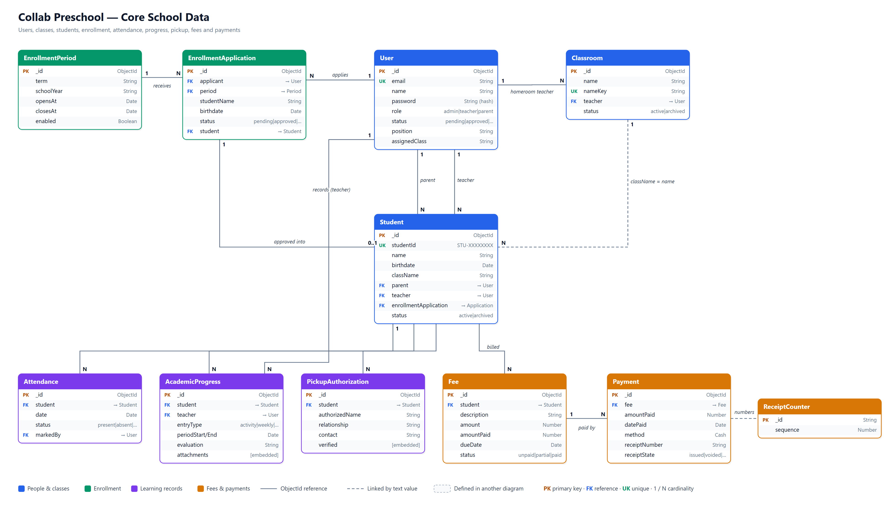
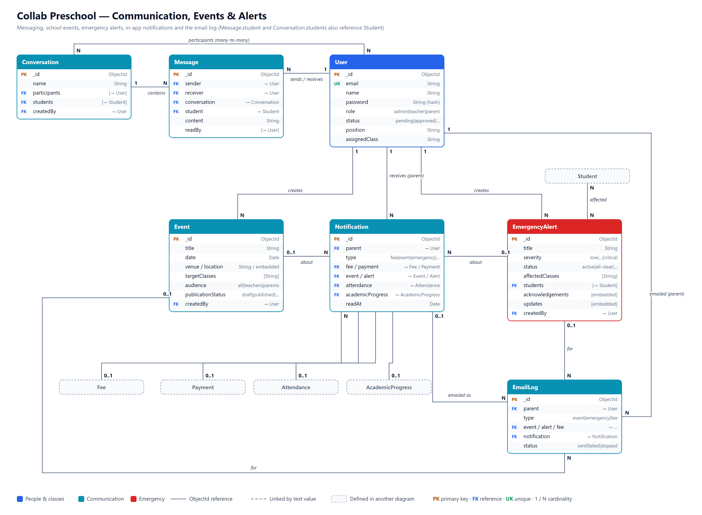
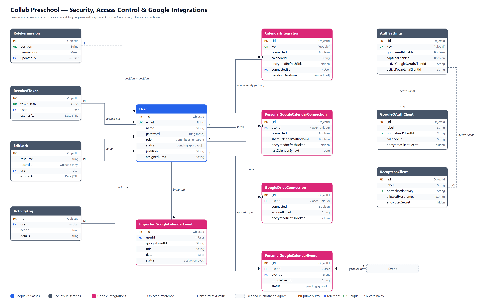
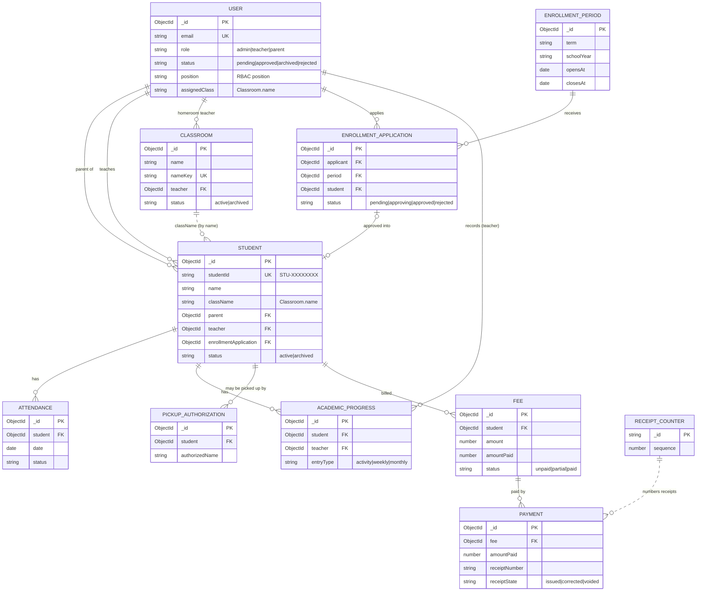
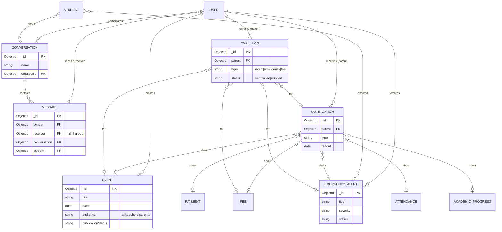
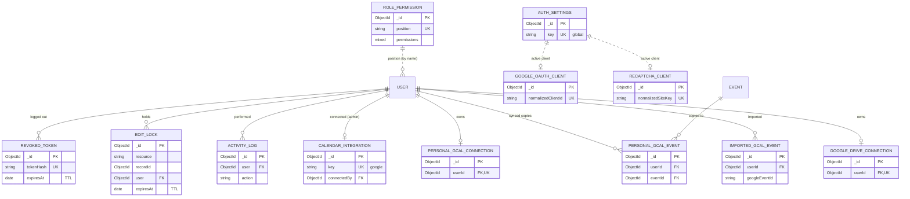

# Data Schema — Collab Preschool

Database: **MongoDB** (via Mongoose). Source of truth: [backend/models/](../backend/models/).

Conventions used throughout:

- Every collection has `_id: ObjectId` (PK). Collections marked **TS** also have `createdAt` / `updatedAt` (Mongoose `timestamps`).
- **FK** = an `ObjectId` reference (`ref`) to another collection. MongoDB does not enforce these; the application does.
- **Hidden** = `select: false`, never returned unless explicitly requested (passwords, tokens, secrets).
- `[ ]` = array; *embedded* = sub-document stored inside the parent, not a separate collection.

---

## 1. Entity-relationship diagram

Rendered images (PNG + SVG in [docs/schema/](schema/); regenerate with `node docs/schema/generate-erd.js docs/schema`):

The Mermaid source below shows the same relationships.

### 1.1 Core school domain

### 1.2 Communication, events and alerts

### 1.3 Security, access control and integrations

Dotted lines (`..`) are **logical links by string value**, not ObjectId references — see §4.

---

## 2. Data dictionary

### 2.1 People and classes

#### `users` — User — TS
Admins, teachers and parents.

| Field | Type | Constraints / default | Notes |
|---|---|---|---|
| name | String | required | Display name |
| firstName, middleName, lastName | String | default `''` | |
| email | String | **required, unique**, lowercase | Login identifier |
| password | String | required unless `googleId`; min 8; **hidden** | bcrypt hash (pre-save hook) |
| googleId | String | unique, sparse | Google sign-in |
| avatar | String | default `null` | |
| address | String | default `''` | |
| childrenNames | [String] | default `[]` | Free text from parent sign-up |
| emailVerified / emailVerifiedAt | Boolean / Date | false / null | |
| emailVerifiedBy | ObjectId → User | | |
| role | String | **required**, `admin` \| `teacher` \| `parent` | |
| phone | String | | |
| employeeId | String | unique, sparse | Staff only |
| assignedClass | String | default `''` | Matches `Classroom.name` |
| employmentStartDate | Date | | |
| employmentType | String | default `''` | |
| documents | [Document] *embedded* | **hidden** | See §2.6 |
| status | String | `pending` \| `approved` \| `archived` \| `rejected`; parents default `pending`, others `approved` | Parents need admin approval |
| position | String | default `null` | RBAC position → `RolePermission.position` |
| customPermissions | Mixed | default `null` | Per-user override |
| sessionsValidAfter | Date | | Tokens issued earlier are rejected |
| archivedAt | Date | indexed | Purged after retention period |
| archivedBy | ObjectId → User | | |
| statusBeforeArchive | String | `pending` \| `approved` \| `rejected` \| null | Restored on un-archive |
| *Security fields* (all **hidden**) | | | `passwordResetOtp*`, `resetPassword*`, `integrationOtp*`, `integrationPin*`, `integrationSaveGrant*`, `googleLogin*` — OTP/PIN hashes, expiry, attempt counters, lockouts |

#### `students` — Student — TS

| Field | Type | Constraints / default | Notes |
|---|---|---|---|
| studentId | String | unique, sparse; default `STU-` + 8 hex | Human-readable ID |
| name | String | **required**, max 120 | |
| birthdate | Date | must not be in the future | |
| photo | Photo *embedded* | | See §2.6 |
| className | String | default `Unassigned` | Matches `Classroom.name` |
| enrollmentDate | Date | default now | |
| guardianName, guardianPhone | String | default `''` | |
| documents | [Document] *embedded* | **hidden** | |
| parent | ObjectId → User | | |
| teacher | ObjectId → User | | |
| enrollmentApplication | ObjectId → EnrollmentApplication | unique, sparse | One student per approved application |
| status | String | `active` \| `archived` | |
| archivedAt | Date | indexed | Auto-set; purged 30 days later |
| archivedBy | ObjectId → User | | |
| notes | String | | |

#### `classrooms` — Classroom — TS

| Field | Type | Constraints / default | Notes |
|---|---|---|---|
| name | String | **required**, max 80 | |
| nameKey | String | **required, unique** | Lower-cased `name` (pre-validate hook) |
| description | String | max 500 | |
| teacher | ObjectId → User | | |
| status | String | `active` \| `archived`, indexed | |
| createdBy | ObjectId → User | | |

#### `pickupauthorizations` — PickupAuthorization — TS

| Field | Type | Constraints / default |
|---|---|---|
| student | ObjectId → Student | **required** |
| authorizedName | String | **required** |
| relationship | String | **required** |
| contact | String | **required** |
| identification | String | default `''` |
| addedBy | ObjectId → User | |
| verified | [{ date: Date, verifiedBy: ObjectId → User }] *embedded* | Pickup verification log |

### 2.2 Enrollment

#### `enrollmentperiods` — EnrollmentPeriod — TS

| Field | Type | Constraints / default |
|---|---|---|
| term | String | **required**, max 80 |
| schoolYear | String | **required**, max 40 |
| opensAt / closesAt | Date | **required** |
| enabled | Boolean | default `true` |
| startedAt | Date | |

#### `enrollmentapplications` — EnrollmentApplication — TS

| Field | Type | Constraints / default | Notes |
|---|---|---|---|
| applicant | ObjectId → User | **required** | |
| submittedRole | String | **required**, `parent` \| `teacher` | |
| parent, teacher | ObjectId → User | | |
| period | ObjectId → EnrollmentPeriod | **required** | |
| term, schoolYear | String | **required** | Copied from period |
| studentName | String | **required**, max 120 | |
| birthdate | Date | **required** | |
| identityKey | String | unique, sparse; **hidden** | Duplicate-application guard |
| guardianName, guardianPhone, requestedClass | String | default `''` | |
| notes | String | max 1000 | |
| studentPhoto | Photo *embedded* | | |
| status | String | `pending` \| `approving` \| `approved` \| `rejected` | `approving` = in-progress lock |
| student | ObjectId → Student | | Set on approval |
| reviewedBy / reviewedAt | ObjectId → User / Date | | |

### 2.3 Learning records

#### `attendances` — Attendance — TS

| Field | Type | Constraints / default |
|---|---|---|
| student | ObjectId → Student | **required** |
| date | Date | **required** |
| status | String | **required**, `present` \| `absent` \| `late` \| `tardy` \| `excused` |
| markedBy | ObjectId → User | |
| remarks | String | |

#### `academicprogresses` — AcademicProgress — TS

| Field | Type | Constraints / default | Notes |
|---|---|---|---|
| student | ObjectId → Student | **required** | |
| teacher | ObjectId → User | **required** | |
| entryType | String | `activity` \| `weekly` \| `monthly`, indexed | |
| periodStart / periodEnd | Date | | For weekly / monthly |
| className | String | | Snapshot of class at time of record |
| date | Date | default now | |
| milestone, activity, assessment, notes | String | | |
| observations, learningArea, evaluation, strengths, areasForImprovement, overallDevelopment | String | default `''` | |
| attachments | [Attachment] *embedded* | | See §2.6 |
| reviewedAt / reviewedBy | Date / ObjectId → User | | |

### 2.4 Fees and payments

#### `fees` — Fee — TS

| Field | Type | Constraints / default | Notes |
|---|---|---|---|
| student | ObjectId → Student | **required** | |
| description | String | **required** | |
| amount | Number | **required**, ≥ 0 | |
| amountPaid | Number | default 0, ≥ 0 | |
| dueDate | Date | **required** | |
| status | String | `unpaid` \| `partial` \| `paid` | Derived by `recomputeStatus()` |
| createdBy | ObjectId → User | | |
| paymentLock | Mixed | **hidden** | Short-lived concurrency lock |

#### `payments` — Payment — TS

| Field | Type | Constraints / default | Notes |
|---|---|---|---|
| fee | ObjectId → Fee | **required** | |
| amountPaid | Number | **required**, ≥ 0.01 | |
| datePaid | Date | default now | |
| method | String | `Cash` | |
| remarks | String | default `''` | |
| receiptNumber | String | | From `ReceiptCounter` |
| receiptState | String | `issued` \| `corrected` \| `voided` | |
| voidedAt | Date | | |
| receiptSnapshot | *embedded* | | Frozen copy of receipt: datePaid, schoolName, studentName, gradeSection, feeName, amountPaid, method, totalFee, totalPaid, remainingBalance, dueDate, status (`Partial Payment` \| `Paid`), recordedBy |
| loggedBy | ObjectId → User | | |

#### `receiptcounters` — ReceiptCounter

| Field | Type | Notes |
|---|---|---|
| _id | String | Counter name (custom PK) |
| sequence | Number | Atomically incremented |

### 2.5 Communication, events and alerts

#### `conversations` — Conversation — TS (group chats)

| Field | Type | Constraints |
|---|---|---|
| name | String | **required**, max 80 |
| participants | [ObjectId → User] | **required** |
| students | [ObjectId → Student] | |
| createdBy | ObjectId → User | **required** |

#### `messages` — Message — TS

| Field | Type | Constraints / default | Notes |
|---|---|---|---|
| sender | ObjectId → User | **required** | |
| receiver | ObjectId → User | required when no `conversation` | Direct message |
| conversation | ObjectId → Conversation | | Group message |
| student | ObjectId → Student | | Optional context |
| content | String | **required** | |
| read | Boolean | default false | Direct messages |
| readBy | [ObjectId → User] | | Group messages |

#### `events` — Event — TS

| Field | Type | Constraints / default | Notes |
|---|---|---|---|
| title | String | **required** | |
| description, time, venue | String | default `''` | |
| date | Date | **required** | |
| location | *embedded* { address, lat (−90..90), lng (−180..180), placeId } | default null | Pinned map location |
| targetType | String | `all` \| `classes` | |
| targetClasses | [String] | | `Classroom.name` values |
| audience | String | `all` \| `teachers` \| `parents` (default) | |
| publicationStatus | String | `draft` \| `pending` \| `published` \| `rejected`, indexed | |
| reviewStatus | String | `not-required` \| `pending` \| `publishing` \| `approved` \| `rejected`, indexed | |
| reviewedBy / reviewedAt / reviewNotes | ObjectId → User / Date / String | | |
| approvalStatus | String | `pending` \| `approved`, indexed | |
| approvedBy / approvedAt | ObjectId → User / Date | | |
| googleCalendar | *embedded* { status, calendarId, eventId, htmlLink, error, lastAttemptAt, lastSyncedAt } | **hidden** | School Google Calendar sync state |
| emailRecipientCount | Number | default 0 | |
| createdBy | ObjectId → User | | |

#### `emergencyalerts` — EmergencyAlert — TS

| Field | Type | Constraints / default | Notes |
|---|---|---|---|
| title, message | String | **required** | |
| emergencyType | String | **required**, default `General` | |
| severity | String | `low` \| `moderate` \| `high` (default) \| `critical` | |
| description, safetyInstructions | String | default `''` | |
| affectedClasses | [String] | | `Classroom.name` values |
| students | [ObjectId → Student] | | |
| status | String | `active` \| `update` \| `all-clear` \| `archived` \| `deleted`, indexed | Soft delete |
| archivedFromStatus | String | `active` \| `update` \| `all-clear` | |
| archivedAt / archivedBy, deletedAt / deletedBy | Date / ObjectId → User | | |
| createdBy | ObjectId → User | **required** | |
| acknowledgements | [{ parent: ObjectId → User, acknowledgedAt }] *embedded* | | |
| updates | [{ _id, message, status: `update` \| `all-clear`, createdBy → User, createdAt }] *embedded* | | Follow-up posts |
| emailRecipientCount | Number | default 0 | |

#### `notifications` — Notification — TS (in-app, for parents)

| Field | Type | Constraints / default | Notes |
|---|---|---|---|
| parent | ObjectId → User | **required**, indexed | Recipient |
| type | String | `fee` \| `event` \| `emergency` \| `attendance` \| `academic-progress`, indexed | |
| priority | Number | default 0, indexed | |
| student | ObjectId → Student | | |
| fee / payment / event / alert / attendance / academicProgress | ObjectId → respective collection | | Only the one matching `type` is set |
| alertUpdate | ObjectId | | `_id` of an entry in `EmergencyAlert.updates` |
| title, message | String | **required** | |
| readAt | Date | null = unread | |

#### `emaillogs` — EmailLog — TS

| Field | Type | Constraints / default |
|---|---|---|
| parent | ObjectId → User | **required**, indexed |
| email | String | **required**, lowercase |
| type | String | **required**, `event` \| `emergency` \| `fee`, indexed |
| event / alert / fee / notification | ObjectId → respective collection | indexed |
| status | String | **required**, `sent` \| `failed` \| `skipped`, indexed |
| errorMessage | String | default `''` |
| sentAt | Date | |

### 2.6 Embedded sub-documents (shared shapes)

| Name | Used in | Fields |
|---|---|---|
| Document | `User.documents`, `Student.documents` | `_id`, originalName, filename, mimetype, size, uploadedAt |
| Photo | `Student.photo`, `EnrollmentApplication.studentPhoto` | filename, mimetype, size, uploadedAt (no `_id`) |
| Attachment | `AcademicProgress.attachments` | `_id`, originalName, filename, mimetype, size, uploadedBy → User, uploadedAt |

Files themselves live on disk under `uploads/`; the database stores only metadata.

### 2.7 Security and access control

#### `rolepermissions` — RolePermission — TS

| Field | Type | Constraints | Notes |
|---|---|---|---|
| position | String | **required, unique** | Overrides defaults in [backend/config/permissions.js](../backend/config/permissions.js) |
| permissions | Mixed | **required** | Permission map |
| updatedBy | ObjectId → User | | |

#### `revokedtokens` — RevokedToken

| Field | Type | Constraints | Notes |
|---|---|---|---|
| tokenHash | String | **required, unique** | SHA-256 of the logged-out JWT |
| user | ObjectId → User | | |
| expiresAt | Date | **required**, **TTL index** | Auto-deleted when the token would have expired |

#### `editlocks` — EditLock (no timestamps)

| Field | Type | Constraints | Notes |
|---|---|---|---|
| resource | String | **required** | e.g. `student`, `user` |
| recordId | ObjectId | **required** | Locked record (any collection) |
| user | ObjectId → User | **required** | Lock holder |
| userName, userRole | String | | Shown to others |
| acquiredAt | Date | default now | |
| expiresAt | Date | **required**, **TTL index** | Renewed by heartbeat |

Unique index on `(resource, recordId)` — one lock per record.

#### `activitylogs` — ActivityLog — TS

| Field | Type | Constraints |
|---|---|---|
| user | ObjectId → User | |
| action | String | **required** |
| details | String | |

#### `authsettings` — AuthSettings — TS (singleton, `key = 'global'`)

| Field | Type | Default |
|---|---|---|
| key | String | unique, `global` |
| googleAuthEnabled | Boolean | true |
| captchaEnabled | Boolean | true |
| customGoogleClientEnabled | Boolean | false |
| customGoogleClientId | String | `''`, max 256 |
| activeGoogleOAuthClientId | String | `default` — `_id` of a GoogleOAuthClient or `default` |
| activeRecaptchaClientId | String | `default` — `_id` of a RecaptchaClient or `default` |

#### `googleoauthclients` — GoogleOAuthClient — TS

| Field | Type | Constraints |
|---|---|---|
| label | String | **required**, max 80 |
| clientId | String | **required**, max 256 |
| callbackUrl | String | **required**, max 2048 |
| normalizedClientId | String | **required, unique** |
| encryptedClientSecret | String | **required, hidden** |

#### `recaptchaclients` — RecaptchaClient — TS

| Field | Type | Constraints |
|---|---|---|
| label | String | **required**, max 80 |
| siteKey | String | **required**, max 256 |
| allowedHostnames | [String] | **required** |
| normalizedSiteKey | String | **required, unique** |
| encryptedSecret | String | **required, hidden** |

### 2.8 Google integrations

#### `calendarintegrations` — CalendarIntegration — TS (singleton, `key = 'google'`)
School-wide Google Calendar.

| Field | Type | Notes |
|---|---|---|
| key | String | unique, `google` |
| connected, needsReconnect | Boolean | |
| accountEmail, calendarId (`primary`), oauthClientSelectionId | String | |
| encryptedRefreshToken | String | **hidden**, AES-256-GCM |
| connectedBy / connectedAt | ObjectId → User / Date | |
| lastError, lastFullSyncAt | String, Date | |
| pendingStateHash, pendingStateExpires, pendingStateUser → User, pendingOAuthClientSelectionId | | **hidden**, OAuth handshake |
| pendingDeletions | [{ calendarId, eventId, title, error, queuedAt }] *embedded* | Retry queue |

#### `personalgooglecalendarconnections` — PersonalGoogleCalendarConnection — TS

| Field | Type | Notes |
|---|---|---|
| userId | ObjectId → User | **required, unique** (1:1) |
| connected, needsReconnect | Boolean | |
| shareCalendarWithSchool / sharedCalendarConsentAt | Boolean / Date | Consent |
| accountEmail, googleAccountId, oauthClientSelectionId | String | |
| encryptedRefreshToken, calendarSyncToken | String | **hidden** |
| lastCalendarSyncAt, lastCalendarSyncError, connectedAt, lastError | | |
| pendingStateHash, pendingStateExpires, pendingOAuthClientSelectionId, pendingShareConsent | | **hidden** |

#### `personalgooglecalendarevents` — PersonalGoogleCalendarEvent — TS
A school Event pushed to a user's own Google Calendar.

| Field | Type | Constraints |
|---|---|---|
| userId | ObjectId → User | **required** |
| eventId | ObjectId → Event | **required** |
| googleEventId | String | **required** |
| calendarId | String | default `primary` |
| status | String | `pending` \| `synced` \| `failed` \| `cancelled` \| `removed` |
| htmlLink, error | String | |
| lastSyncedAt | Date | |

Unique index on `(userId, eventId)`.

#### `importedgooglecalendarevents` — ImportedGoogleCalendarEvent — TS
Events pulled in from a user's Google Calendar.

| Field | Type | Constraints |
|---|---|---|
| userId | ObjectId → User | **required** |
| googleEventId | String | **required** |
| status | String | `active` \| `removed`, indexed |
| title | String | **required** |
| description, time, venue, htmlLink | String | |
| date | Date | **required**, indexed |
| allDay | Boolean | default false |
| googleUpdatedAt, lastSyncedAt | Date | |

Unique index on `(userId, googleEventId)`.

#### `googledriveconnections` — GoogleDriveConnection — TS

| Field | Type | Notes |
|---|---|---|
| userId | ObjectId → User | **required, unique** (1:1) |
| connected, needsReconnect | Boolean | |
| pickerScopeVersion | Number | |
| accountEmail, googleAccountId, oauthClientSelectionId | String | |
| encryptedRefreshToken | String | **hidden** |
| connectedAt, lastError | Date, String | |
| pendingStateHash, pendingStateExpires, pendingOAuthClientSelectionId | | **hidden** |

---

## 3. Indexes and uniqueness rules

| Collection | Index | Type | Purpose |
|---|---|---|---|
| users | `email` | unique | One account per email |
| users | `googleId`, `employeeId` | unique, sparse | |
| users | `archivedAt` | | Archive purge job |
| students | `studentId` | unique, sparse | |
| students | `enrollmentApplication` | unique, sparse | One student per application |
| students | `archivedAt` | | 30-day purge |
| classrooms | `nameKey` | unique | Case-insensitive class names |
| classrooms | `status` | | |
| attendances | `(student, date)` | **unique** | One record per student per day |
| academicprogresses | `(student, entryType, periodStart)`; `entryType` | | |
| enrollmentapplications | `(applicant, period, studentName)` | | |
| enrollmentapplications | `identityKey` | unique, sparse | Duplicate guard |
| messages | `(conversation, createdAt)` | | Chat history |
| conversations | `(participants, updatedAt desc)` | | Inbox listing |
| notifications | `(parent, attendance)` | unique, partial (`type = 'attendance'`) | No duplicate attendance alerts |
| notifications | `parent`, `type`, `priority` | | |
| emaillogs | `parent`, `type`, `event`, `alert`, `fee`, `notification`, `status` | | |
| events | `publicationStatus`, `reviewStatus`, `approvalStatus` | | |
| emergencyalerts | `status` | | |
| editlocks | `(resource, recordId)` | unique | One lock per record |
| editlocks | `expiresAt` | **TTL** | Auto-expire |
| revokedtokens | `tokenHash` | unique | |
| revokedtokens | `expiresAt` | **TTL** | Auto-expire |
| rolepermissions | `position` | unique | |
| googleoauthclients | `normalizedClientId` | unique | |
| recaptchaclients | `normalizedSiteKey` | unique | |
| authsettings / calendarintegrations | `key` | unique | Singletons |
| personalgooglecalendarconnections | `userId` unique; `(connected, lastCalendarSyncAt)` | | |
| personalgooglecalendarevents | `(userId, eventId)` | unique | |
| importedgooglecalendarevents | `(userId, googleEventId)` unique; `(userId, status)`; `date`; `status` | | |
| googledriveconnections | `userId` | unique | |

---

## 4. Logical (string-based) relationships

These links are stored as plain strings rather than ObjectIds, so renaming the referenced value must update the referring records:

| From | To | Matched on |
|---|---|---|
| `Student.className` | `Classroom` | `Classroom.name` |
| `User.assignedClass` | `Classroom` | `Classroom.name` |
| `Event.targetClasses[]` | `Classroom` | `Classroom.name` |
| `EmergencyAlert.affectedClasses[]` | `Classroom` | `Classroom.name` |
| `AcademicProgress.className` | `Classroom` | historical snapshot — intentionally not updated |
| `User.position` | `RolePermission` | `RolePermission.position` (falls back to `config/permissions.js`) |
| `AuthSettings.activeGoogleOAuthClientId` | `GoogleOAuthClient` | `_id` as string, or `default` |
| `AuthSettings.activeRecaptchaClientId` | `RecaptchaClient` | `_id` as string, or `default` |
| `Notification.alertUpdate` | `EmergencyAlert.updates[]._id` | embedded sub-document id |
| `EditLock.recordId` | any collection named in `resource` | polymorphic |

---

## 5. Key lifecycle rules

- **User status:** parents self-register as `pending` → admin sets `approved` or `rejected`. Admins and teachers start `approved`. Archiving saves `statusBeforeArchive`; archived accounts are purged after `ARCHIVE_RETENTION_DAYS` (30).
- **Student status:** `active` ↔ `archived`. Saving with `archived` sets `archivedAt`; restoring clears it. Purged 30 days after archiving.
- **Enrollment:** `pending` → `approving` (lock) → `approved` (creates `Student`, sets `student`) or `rejected`.
- **Fee status:** derived from `amountPaid` vs `amount` (`unpaid` / `partial` / `paid`); `Fee.amountPaid` is recomputed as the sum of the fee's non-voided `Payment.amountPaid`.
- **Receipts:** `issued` → `corrected` or `voided`; `receiptSnapshot` keeps the printed values unchanged.
- **Events:** `publicationStatus` (`draft` / `pending` / `published` / `rejected`) and `reviewStatus` track teacher-submitted events awaiting admin review.
- **Emergency alerts:** `active` → `update`* → `all-clear` → `archived`; `deleted` is a soft delete.
- **Auto-expiring data:** `EditLock` and `RevokedToken` are removed by MongoDB TTL indexes.
